# Draw.io Neural Network Model Library

A collection of **159 ready-to-use neural network architecture templates** for [draw.io](https://app.diagrams.net/), designed for academic papers, technical reports, and presentations. All diagrams follow IEEE Transactions color conventions with a consistent, professional style.

## How to Use

Open `nn_model_library.xml` in draw.io (File > Open Library) to load all 159 templates into the scratchpad. Drag any template onto your canvas and customize as needed.

Each category is also available as a smaller library in `libraries/`, and `nn_components.xml` holds single blocks, operators, arrows and a color legend for drawing your own architectures.

Alternatively, individual `.drawio` files are available in `exports/drawio/` for standalone use.

## Preview

### CNN Architectures

<table>
<tr>
<td align="center"><b>LeNet-5</b></td>
<td align="center"><b>ResNet Block</b></td>
<td align="center"><b>MobileNet Block</b></td>
<td align="center"><b>Inception Module</b></td>
</tr>
<tr>
<td>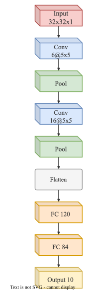</td>
<td>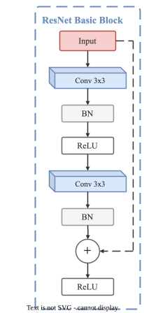</td>
<td>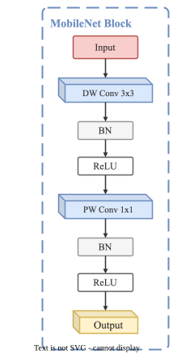</td>
<td>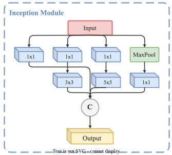</td>
</tr>
</table>

### Transformer Architectures

<table>
<tr>
<td align="center"><b>Vision Transformer (ViT)</b></td>
<td align="center"><b>Transformer Encoder</b></td>
<td align="center"><b>Swin Transformer Block</b></td>
</tr>
<tr>
<td>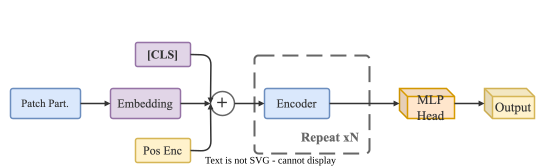</td>
<td>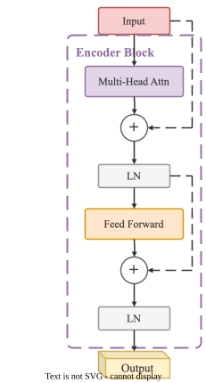</td>
<td>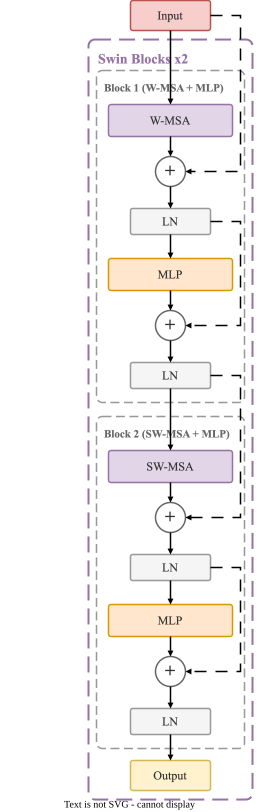</td>
</tr>
</table>

### Sequence Models

<table>
<tr>
<td align="center"><b>Seq2Seq + Attention</b></td>
<td align="center"><b>BERT Block</b></td>
<td align="center"><b>GPT Block</b></td>
</tr>
<tr>
<td>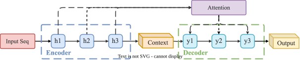</td>
<td>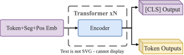</td>
<td>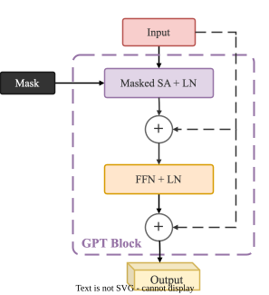</td>
</tr>
</table>

### Detection & Segmentation

<table>
<tr>
<td align="center"><b>U-Net</b></td>
<td align="center"><b>Faster R-CNN</b></td>
</tr>
<tr>
<td>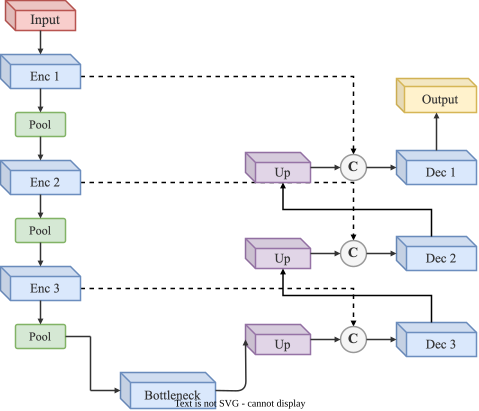</td>
<td>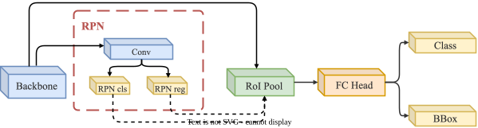</td>
</tr>
</table>

## Full Template List (159 Models)

**CNNs:** LeNet-5, AlexNet, VGG Block, ResNet Block, ResNet Bottleneck, DenseNet Block, MobileNet Block, EfficientNet MBConv, Inception Module, SE Block, CBAM, ConvNeXt Block, ResNeXt Block, Depthwise Separable Conv, ShuffleNet V2 Unit, RepVGG Block, Ghost Module, HRNet Stage

**Transformers:** Transformer Encoder, Transformer Decoder, Full Transformer, ViT, Swin Transformer Block, Multi-Head Attention Detail, MLP-Mixer, Scaled Dot-Product Attention, Cross-Attention Block, Pre-LN vs Post-LN, Attention Masks, Sparse Attention Patterns, Linear Attention, Swin Transformer, DeiT, PVT Stage, Perceiver IO, MaxViT Block, Patch Embedding

**NLP Models:** BERT Block, GPT Block, Seq2Seq, Seq2Seq + Attention, LLaMA Decoder Block, Grouped-Query Attention, Multi-Head Latent Attention, MoE Layer, SwiGLU FFN, Rotary Position Embedding, Decoder-Only LLM, T5 Encoder-Decoder

**RNNs:** Stacked LSTM, Stacked GRU, Bi-LSTM, LSTM Cell, GRU Cell

**Sequence Models:** TCN Residual Block, WaveNet, Conformer Block, Mamba Block, Selective SSM

**Detection & Segmentation:** Faster R-CNN, FPN, YOLO Head, U-Net, FCN Decoder, ASPP Module, DETR, Mask R-CNN, RetinaNet, SSD, YOLOv8, C2f Block, PANet, CenterNet, DeepLabv3+, PSPNet, SAM, Mask2Former, SegFormer, Attention U-Net, UNet++

**Generative Models:** GAN, DCGAN Generator, DCGAN Discriminator, Conditional GAN, VAE, Autoencoder, VQ-VAE, VQGAN, StyleGAN Generator, CycleGAN, Pix2Pix, RealNVP Coupling Layer, PixelCNN

**Diffusion Models:** DDPM Process, Diffusion U-Net, Time-Conditioned ResBlock, Latent Diffusion, DiT Block, ControlNet, Classifier-Free Guidance, Flow Matching

**Multimodal:** CLIP, BLIP-2, Q-Former, LLaVA, Flamingo, Early vs Late Fusion, Whisper

**Self-Supervised:** SimCLR, MoCo, BYOL, SimSiam, MAE, DINO, Barlow Twins, Triplet Network

**Graph Neural Networks:** GCN Layer, GraphSAGE, GIN, Message Passing, Graph Classification Pipeline, Graph Transformer, ST-GCN

**Reinforcement Learning:** Agent-Environment Loop, DQN, Dueling DQN, Actor-Critic, PPO, AlphaZero, Dreamer

**3D Vision:** PointNet, PointNet++ Set Abstraction, DGCNN EdgeConv, NeRF, 3D Gaussian Splatting, VoxNet, Multi-View CNN

**Scientific ML:** PINN, Neural ODE, KAN Layer, Fourier Neural Operator, DeepONet, Capsule Network

**Recommender Systems:** Wide & Deep, DeepFM, DCN, DLRM, Two-Tower, DIN

**Training & Systems:** LoRA, KV Cache Decoding, Speculative Decoding, RLHF Pipeline, DPO, RAG Pipeline, ReAct Agent Loop, Knowledge Distillation

**Other:** GAT Layer, Siamese Network

## Color Scheme

All templates use a standardized IEEE Transactions academic color palette.

| Component | Fill | Stroke |
|-----------|------|--------|
| Attention | `#E1D5E7` | `#9673A6` |
| Convolution | `#DAE8FC` | `#6C8EBF` |
| Deconvolution | `#DCEEF8` | `#56A5C9` |
| RNN (LSTM/GRU) | `#D4EDDA` | `#28A745` |
| Pooling | `#D5E8D4` | `#82B366` |
| Normalization | `#F5F5F5` | `#999999` |
| FC / MLP | `#FFE6CC` | `#D79B00` |
| Input | `#F8CECC` | `#B85450` |
| Output | `#FFF2CC` | `#D6B656` |
| Operators | `#FFFFFF` | `#666666` |
| State Space / Memory | `#D5F0EE` | `#4A9C94` |
| Gating / Routing | `#F9DCEB` | `#B5739D` |

## License

This library is provided under the [MIT License](LICENSE). Feel free to use these templates in your papers, presentations, and projects.
